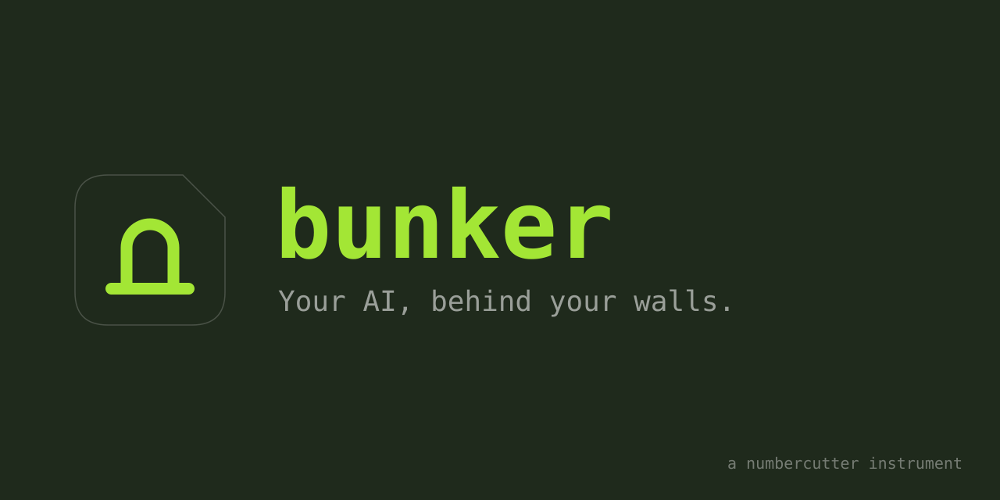

<p align="center"></p>

**Your AI, behind your walls.**

bunker runs a private AI stack (Ollama, Open WebUI, Qdrant and Postgres) with one command on Docker networks that have no route to the internet. Only a small reverse proxy touches a normal network, its port is bound to your own machine, and `bunker check` proves the rest is sealed.

## Quick start

Needs Docker with the Compose plugin. `./bunker doctor` says what is missing and how to fix it.

```sh
git clone https://github.com/numbercutter/bunker && cd bunker
./bunker doctor                  # docker, daemon, compose plugin, gpu or host ollama
./bunker up                      # writes .env with fresh secrets, starts the stack
./bunker pull llama3.2:3b        # a chat model
./bunker pull nomic-embed-text   # embeddings for document search
./bunker check                   # PASS means the sealed networks have no way out
```

Open http://127.0.0.1:3000 and create the first account (it becomes the admin).

## Usage

```
bunker up [--cpu|--gpu|--host]   start the stack (creates .env on first run)
bunker down                      stop the stack, keep data
bunker status                    containers and installed models
bunker pull <model>              download a model into the shared volume
bunker check                     prove the sealed networks have no outbound route
bunker logs [service]            follow logs
bunker backup [--skip-models] [dir]
                                 archive the volumes to dir (default ./backups)
bunker restore <file> [--yes]    replace the volumes with an archive from backup
bunker doctor                    explain what is missing and how to fix it
```

`examples/first-run.sh` runs the full sequence, asks the model one question and writes a backup.

### Modes

The mode is saved in `.env` as `BUNKER_MODE`; passing a different flag to `up` stops the stack and switches.

- `--cpu` (default) runs Ollama in a container on the CPU.
- `--gpu` runs Ollama with an NVIDIA GPU reservation (compose profile `gpu`). Linux only: install the NVIDIA driver and the [NVIDIA Container Toolkit](https://docs.nvidia.com/datacenter/cloud-native/container-toolkit/latest/install-guide.html), run `sudo nvidia-ctk runtime configure --runtime=docker && sudo systemctl restart docker`, then `bunker doctor` confirms the runtime is registered.
- `--host` uses an Ollama already running on this machine instead of a container. On Apple Silicon this is the way to use the Mac GPU: Docker runs in a Linux VM and cannot reach Metal, so a containerised Ollama is CPU only. Install Ollama for macOS, run `ollama serve`, pull models with `ollama pull`, then `bunker up --host`. Open WebUI stays sealed; the proxy forwards its Ollama requests to `host.docker.internal:11434` (set `BUNKER_HOST_OLLAMA` in `.env` to change it).

### Backups

`bunker backup` stops the stack if it is running, tars the `bunker_*` volumes through a throwaway Alpine container into one `.tar.gz`, and starts the stack again. `--skip-models` leaves out the model volume, which is usually the largest and can be pulled again. `bunker restore <file>` stops the stack, empties only the volumes the archive contains, and unpacks it; it asks you to type `yes` unless you pass `--yes`.

## How it works

| network | members | internet |
|---|---|---|
| `bunker_core` (`internal: true`) | ollama, qdrant, postgres, open-webui | none |
| `bunker_front` (`internal: true`) | open-webui, proxy | none |
| `bunker_edge` | proxy | yes, used to publish `127.0.0.1:3000` |

- Ollama, Qdrant, Postgres and Open WebUI sit only on internal networks. Docker creates those without a gateway, so these containers cannot open a connection outside the host.
- The proxy is Caddy with its admin API, automatic HTTPS and saved config turned off (`src/Caddyfile`). It is the only container on `bunker_edge` and the only one with a published port, bound to `127.0.0.1` only. It is not on `bunker_core`, so it cannot reach the database or the vector store directly.
- Open WebUI's offline settings are on (`OFFLINE_MODE`, `HF_HUB_OFFLINE`, no OpenAI API, no web search, no update check, no telemetry) and embeddings come from Ollama, not a Hugging Face download.
- Model downloads need the internet, so `bunker pull` starts a temporary Ollama container on Docker's default network, writes into the `bunker_models` volume the stack uses, and exits. The running stack never gains a route out.
- `bunker check` starts a throwaway Alpine container on each internal network and tries `http://1.1.1.1` and `http://example.com`, then lists the containers on `bunker_edge`. It reports PASS only if both networks are marked internal, every attempt fails, and the proxy is the only edge member.
- Every image is pinned to a version tag. Upgrading is a deliberate edit to `docker-compose.yml`.

## Limits

What "no outbound access" covers: containers on `bunker_core` and `bunker_front` cannot reach the internet or your LAN over IP, and DNS names outside the stack do not resolve.

What it does not cover:

- **The proxy can reach out.** It sits on `bunker_edge`, which has a normal gateway. It runs a fixed config that only forwards to Open WebUI (and, in `--host` mode, to the host Ollama), but it is the one container with a route out.
- **`--host` mode trusts the host Ollama.** Model inference then runs outside Docker, on a process with the host's network access.
- **The host is not sealed.** Anything running on your machine, including Docker itself pulling images, still has internet access. bunker isolates containers, not the computer.
- **Pulls trust the source.** `bunker pull` downloads from the Ollama registry. Check what you pull.
- **`check` is a probe, not a proof.** It tests two destinations on two protocols from one container per network and reads edge membership. It does not audit firewall rules, IPv6 settings or other Docker networks you attach later.
- **Local access is not authentication.** Anyone with a shell on this machine can open `127.0.0.1:3000`. Open WebUI's own accounts are the only gate.
- **Backups stop the stack** for a few seconds to minutes so Postgres is copied at rest, and the archive is not encrypted. Store it like the data it holds.
- **The GPU profile is NVIDIA only.** AMD (ROCm) needs a different Ollama image and device mapping.

## Works with

[sieve](https://github.com/numbercutter/sieve) runs its local triage against the same Ollama when you use `bunker up --host`, and [attic](https://github.com/numbercutter/attic) keeps your notes searchable on the same machine. Neither sends your data out.

<sub>A numbercutter instrument · MIT</sub>
